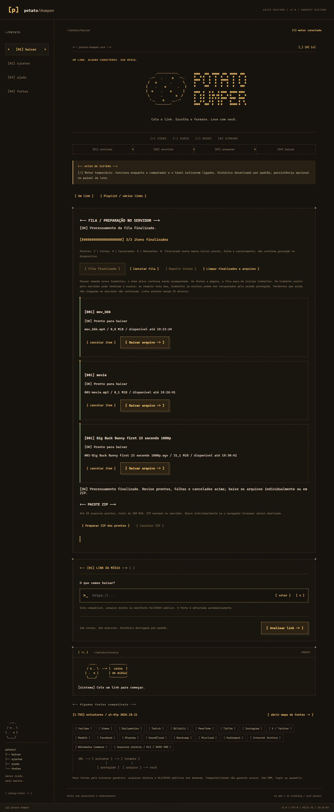

# [p] Potato Dumper

Downloader de mídia com identidade própria em ASCII. Frontend em português, tons de batata, análise real de formatos e preparação de arquivos com **yt-dlp + ffmpeg**. Não usa API, instância nem código do Cobalt.

- **Frontend:** https://harleyzinn.github.io/potato-downloader/
- **Código:** https://github.com/Harleyzinn/potato-downloader



## Estado da instalação

O frontend é permanente no GitHub Pages. A primeira instalação do backend usa **um túnel HTTPS temporário para este computador**, sem contratação ou cobrança. Ele só funciona enquanto o computador, o processo do motor e o `cloudflared` estiverem ligados. A interface avisa quando esse motor é temporário ou está desconectado. **Não é uma hospedagem de backend permanente.** Ao reiniciar o Quick Tunnel, atualize a variável pública `VITE_API_URL` e publique novamente.

Para funcionar continuamente com seu computador desligado, instale o backend em um servidor Linux/Docker que você controla, com endereço HTTPS estável. GitHub Pages não executa Node, Python, yt-dlp ou ffmpeg. Não é possível substituir esse servidor por um workflow de download ou por um arquivo estático.

## Arquitetura e escolhas

```text
GitHub Pages (HTML/CSS/TypeScript)
        | HTTPS + CORS
        v
Potato API (Node / TypeScript)
        | análise JSON / seleção de formato / processo limitado
        v
yt-dlp -> proxy local com validação e pinagem DNS -> plataforma pública
        | arquivo local -> ffmpeg quando necessário
        v
arquivo temporário -> streaming HTTP -> navegador
```

Vite + TypeScript sem framework de UI: componentes pequenos de apresentação, serviço tipado, preferências e estado separados. O yt-dlp detecta automaticamente a fonte pelo link HTTP/HTTPS e escolhe um extrator específico ou genérico. A API guarda as opções extraídas e aceita apenas esses IDs na preparação; não expõe um endpoint que encaminhe cegamente um destino arbitrário. O navegador não recebe comandos de execução nem decide caminhos de arquivos.

O backend usa o contrato documentado de `yt-dlp`: `--dump-single-json`, seleção `-f`, `--progress-template`, extração de áudio e arquivos locais. Nenhuma API pública de terceiros é presumida. O Cobalt foi pesquisado inicialmente e descartado; não é dependência deste projeto. [Documentação do yt-dlp](https://github.com/yt-dlp/yt-dlp#readme), [sites suportados pelo extrator](https://github.com/yt-dlp/yt-dlp/blob/master/supportedsites.md), [ffmpeg](https://ffmpeg.org/documentation.html), [GitHub Pages com Actions](https://docs.github.com/en/pages/getting-started-with-github-pages/using-custom-workflows-with-github-pages).

## Requisitos

- Node 24 recomendado (mínimo 22.12), npm e Git.
- yt-dlp instalado no servidor. Versão testada: **2026.10.21**.
- ffmpeg: `npm ci` instala o binário via `ffmpeg-static`; alternativamente configure `FFMPEG_PATH` para uma instalação do sistema.
- Acesso de rede às plataformas, disco temporário e permissão para executar processos.
- Hospedagem de backend com processos nativos e requisições longas. Funções serverless comuns não são adequadas a esta arquitetura.

## Instalação local no Windows

No PowerShell, na pasta onde deseja guardar o projeto:

```powershell
git clone https://github.com/Harleyzinn/potato-downloader.git
cd potato-downloader
npm ci
Copy-Item .env.example .env
New-Item -ItemType Directory -Force .runtime
Invoke-WebRequest https://github.com/yt-dlp/yt-dlp/releases/download/2026.10.21/yt-dlp.exe -OutFile .runtime/yt-dlp.exe
npm run backend
```

Mantenha esse terminal aberto. Em outro terminal na mesma pasta:

```powershell
npm run dev
```

Abra **http://127.0.0.1:5173/potato-downloader/**. O Vite encaminha `/api` ao motor local em `127.0.0.1:8787`. Apenas `VITE_API_URL` vazio em desenvolvimento usa esse encaminhamento; não coloque a URL pública temporária no `.env` se quiser testar localmente.

### Conectar o Pages ao computador por HTTPS

Este modo serve para testes e uso temporário, sem garantia de uptime. [Limitações oficiais dos Quick Tunnels](https://developers.cloudflare.com/tunnel/get-started/quick-tunnels/).

```powershell
Invoke-WebRequest https://github.com/cloudflare/cloudflared/releases/latest/download/cloudflared-windows-amd64.exe -OutFile .runtime/cloudflared.exe
.\.runtime\cloudflared.exe tunnel --url http://127.0.0.1:8787 --protocol http2 --no-autoupdate
```

Copie a URL **HTTPS** impressa pelo túnel e configure a variável de repositório `VITE_API_URL` conforme a seção Pages abaixo. Não aponte para portas de administração nem outros serviços. O túnel expõe apenas a API Potato local. Para sinalizar o modo temporário, inicie o backend com `$env:TEMPORARY_HOST='1'` antes de `npm run backend`.

O backend e o túnel foram deixados em execução na primeira entrega. Não dependem de uma instalação global ou alteração de configurações do Windows. Ao encerrá-los ou desligar o computador, a interface do Pages permanece disponível, mas a análise deixa de funcionar até reconectar um motor.

## Backend permanente com Docker

```sh
docker compose up -d --build
```

O Compose vincula a API apenas a `127.0.0.1:8787`, limita memória/CPU/processos e usa `/tmp` em memória com limite de 512 MiB. Os arquivos de até 100 MiB são preparados ali. Configure seu proxy HTTPS ou túnel nomeado para encaminhar ao backend. Use um serviço já disponível; o projeto não cria contas, assinaturas ou infraestrutura cobrada.

Na hospedagem, use a imagem do `Dockerfile`, mantenha `HOST=0.0.0.0` dentro do contêiner e configure `ALLOWED_ORIGINS`. O backend não serve o frontend. O Dockerfile é fornecido para instalação reproduzível; sua execução em Linux/Docker não foi verificada neste computador sem Docker.

O Quick Tunnel usado na entrega é temporário. Não existe serviço gratuito permanente contratado/configurado automaticamente. Para publicação contínua, é necessário um servidor ou uma conta de hospedagem autorizada.

## Variáveis de ambiente

| Variável | Visibilidade | Uso |
|---|---|---|
| `VITE_API_URL` | **Pública**, incorporada ao JS | URL HTTPS da API, sem `/api` no final. Nunca coloque chave, senha ou token. |
| `HOST`, `PORT` | Servidor | Padrões `127.0.0.1`, `8787`. |
| `ALLOWED_ORIGINS` | Servidor | Origens exatas separadas por vírgula, incluindo `https://harleyzinn.github.io`. |
| `YTDLP_PATH` | Servidor | Executável confiável instalado pelo administrador. No Windows detecta `.runtime/yt-dlp.exe`. |
| `FFMPEG_PATH` | Servidor | Executável ffmpeg. Padrão do pacote `ffmpeg-static`. |
| `TEMP_ROOT` | Servidor | Pasta exclusiva para os temporários do Potato. Padrão na pasta temporária do sistema. |
| `TEMPORARY_HOST` | Servidor | `1` avisa na interface que a hospedagem é temporária. |

Esta implementação não requer credenciais de plataforma. `.env`, `.runtime` e binários baixados são ignorados pelo Git. Não habilita login, cookies, plugins de extrator, DRM ou acesso privado.

## Publicação no GitHub Pages

1. Em **Settings > Pages > Source**, selecione **GitHub Actions**.
2. Em **Settings > Secrets and variables > Actions > Variables**, crie a variável pública de repositório `VITE_API_URL` com a URL HTTPS do backend.
3. Envie para `main` ou execute **Actions > Checks and GitHub Pages > Run workflow**.
4. O workflow instala com `npm ci`, executa lint, tipos, testes, build e publica somente após passar. Pull requests executam checks sem publicação.

O caminho base do Vite é `/potato-downloader/`. Assets são emitidos nesse caminho e a navegação usa `#baixar`, `#ajustes` e `#ajuda`, sem necessidade de rewrite. A publicação usa `upload-pages-artifact` e `deploy-pages`, com `GITHUB_TOKEN` e permissões `pages: write` e `id-token: write` somente no job de deploy. Não usa token pessoal. Variáveis de repositório não são segredos; alterações de URL exigem novo build.

### CORS

O backend permite a origem exata `https://harleyzinn.github.io` (a origem não inclui `/potato-downloader/`). Permite preflight para GET, POST e DELETE com `Content-Type`, sem credenciais e sem wildcard. Não há cookies. Origens não autorizadas recebem 403. HTTPS no frontend exige HTTPS no backend, evitando conteúdo misto.

## Recursos e limites reais

- Validação do link; limpar, colar por ação explícita com fallback manual, Enter, cancelamento de análise/preparação e novo link sem recarregar.
- Análise com título, autoria e duração quando informados pela origem. Não inventa capas, tamanhos ou metadados.
- Automático, vídeo e áudio conforme os formatos extraídos. Vídeo ausente fica desativado para mídia de áudio.
- Qualidade de origem, extração e conversão para MP3, Opus ou WAV usando ffmpeg. Não oferece upscale nem formato de vídeo inventado.
- Playlists e galerias quando o extrator retorna entradas públicas: listagem em páginas de 25, até 200 itens; fila de até 20 itens. Nem toda galeria de fotos de Instagram/TikTok é suportada.
- Progresso real do download **para o servidor** quando o motor informa bytes totais; indicador indeterminado nos demais casos. Em streams separados o percentual pode reiniciar para a segunda faixa. Conversão não tem percentual fictício.
- Após preparação, streaming com `Content-Disposition` e nome sanitizado. Ao clicar, mostra **Download iniciado**; não alega que o arquivo foi salvo.
- 100 MiB por trabalho, 20 minutos por mídia, 2 processos simultâneos, 90 s de análise e 8 min de preparação, retenção de até 15 min. Conversão pode ultrapassar tamanho e ser cancelada.
- Preferências locais, restauração de padrões, movimento reduzido e navegação por teclado. Histórico desativado por padrão; persistência opcional de rascunhos de lote.

### Cobertura ampliada (v2.1)

A lista fixa de nove domínios foi substituída pela descoberta do **yt-dlp instalado**. O endpoint `/api/compatibility` consulta `--list-extractors` e `--version` ao iniciar o backend. Nesta instalação: **1.755 extratores**, dos quais **136** se declaram `CURRENTLY BROKEN`. Isso é uma contagem de extratores, não de sites funcionando.

A tela ASCII **[04] fontes** apresenta **Algumas fontes compatíveis**: uma seleção ilustrativa de vídeo, redes sociais e áudio, com pesquisa, indicação de extratores quebrados e registros separados de downloads reais. Exemplos: YouTube, Vimeo, Dailymotion, Twitch, Bilibili, PeerTube, TikTok, Instagram, X, Reddit, Facebook, Bluesky, SoundCloud, Bandcamp, Mixcloud, Audiomack e Wikimedia Commons. A lista visual não é completa nem funciona como allowlist. O campo de URL permanece genérico.

Alguns nomes foram retirados apenas da seleção e pesquisa visuais e dos exemplos promocionais. Isso não remove seus extratores do executável nem os bloqueia na validação do servidor. O inventário técnico da API continua completo, enquanto `src/presentation.ts` controla somente a exibição. Os totais informam o inventário instalado, não a quantidade de exemplos exibidos. Restrições de acesso, idade, região, DRM e ausência de formatos ainda podem impedir o uso. Não há importação de senhas ou cookies de contas; a alteração visual não constitui um novo teste de nenhuma fonte.

Páginas genéricas, **arquivos HTTP/HTTPS diretos**, **HLS (`.m3u8`) e DASH (`.mpd`) sob demanda** são aceitos quando o extrator genérico e o downloader nativo encontram formatos compatíveis. Não é preciso editar uma lista de domínios para cada nova fonte. Não há suporte a `file://`, RTMP/RTSP, DRM ou gravação ao vivo. Galerias mostram até oito entradas com formatos válidos; fotos ou entradas sem formatos não são inventadas. Uma galeria pode retornar apenas os itens compatíveis.

Arquivos diretos sem metadados de codec têm até **4 MiB** iniciais lidos pelo backend (inclusive se a origem ignorar Range). Os redirecionamentos são revalidados e o IP público é fixado no socket. O FFmpeg inspeciona somente o cabeçalho local, com demuxer fixo e rede desativada para essa inspeção. Arquivos que precisam de um cabeçalho fora desse limite, como alguns MP4 com `moov` no final, podem ser recusados. Não se presume que a extensão do arquivo prova que existem áudio ou vídeo.

**Listado** = extrator presente na ferramenta, sem garantia de acesso. **Quebrado** = sinalizado pela própria ferramenta. **Testado** = mídia, versão e escopo registrados em `backend/verified-sources.json`, após download e transferência reais. Testes antigos mantêm sua versão original mesmo após atualizar o motor. Consulte [a lista oficial e suas ressalvas](https://github.com/yt-dlp/yt-dlp/blob/master/supportedsites.md) e [VERIFICATION.md](VERIFICATION.md).

### Atualizar o motor sem reescrever a interface

Para o executável oficial instalado no Windows:

```sh
npm run engine:update
```

Depois, reinicie o backend. O inventário da interface vem da API e acompanha a nova versão automaticamente. Não é necessário reconstruir o frontend; registre novos testes somente após fazê-los de verdade. Para uma instalação Python, atualize `yt-dlp[default]` no ambiente virtual. O script de atualização não aceita parâmetros enviados por visitantes nem executa plugins.

No Docker, substitua a versão pela release oficial que deseja instalar:

```sh
docker compose build --build-arg YTDLP_VERSION=2026.10.21
docker compose up -d
```

O argumento de build mantém a versão reproduzível; não usa atualizações silenciosas em cada requisição. As opções usadas são documentadas no [README oficial](https://github.com/yt-dlp/yt-dlp#usage-and-options). A configuração local e os diretórios de plugins são ignorados; não são ativados `.netrc`, login, cookies de navegador, falsificação de região ou download de componentes remotos.

## Escolha do mecanismo (revisão em 24/10/2026)

**Decisão: manter yt-dlp + FFmpeg.** A solução atual já usa esse motor; não é um terceiro extrator concorrente. Foram consultadas a [tabela oficial de serviços do Cobalt](https://github.com/imputnet/cobalt/blob/main/api/README.md#supported-services), sua [API](https://github.com/imputnet/cobalt/blob/main/docs/api.md) e [instalação própria](https://github.com/imputnet/cobalt/blob/main/docs/run-an-instance.md), além do [manual](https://github.com/yt-dlp/yt-dlp#readme) e da [lista com ressalvas do yt-dlp](https://github.com/yt-dlp/yt-dlp/blob/master/supportedsites.md).

| Critério | Cobalt documentado | yt-dlp e implementação atual |
|---|---|---|
| Variedade útil | Serviços explicitamente integrados, incluindo redes sociais, vídeo e SoundCloud. | Extratores específicos e genérico; no Potato já foram verificados arquivos diretos e manifests HLS/DASH VOD. |
| Recursos | Vídeo/áudio, modos, qualidade, formatos e seleção múltipla; vantagens documentadas em fotos e slideshows de algumas redes. | Seleção de formatos reais, extração/conversão de áudio e remux com FFmpeg; a UI atual não promete galerias de fotos universais. |
| Confiabilidade | A documentação aponta limitações por serviço, como áudio no Vimeo apenas via DASH e possíveis falhas no X. Não foi executado um comparativo local com Cobalt. | A lista oficial também não garante funcionamento. Mantemos versão, extratores quebrados e escopo dos testes reais separados. |
| Manutenção | Outra API, atualizações, configuração e proteção da instância. | Atualização do executável/pacote e reinício do motor; catálogo dinâmico, sem reescrever a interface. |
| Hospedagem | Docker Compose recomendado, backend com processamento e URL do túnel; uso de API hospedada depende de autorização. | Node, yt-dlp/Python ou executável e FFmpeg. O backend atual já funciona com esses requisitos; Pages hospeda somente o frontend. |

A escolha considera os fluxos verificados e a operação disponível, **não só a contagem de extratores**. Não há evidência obtida nesta revisão de que trocar o motor melhore os downloads já funcionais. Combinar Cobalt agora acrescentaria um segundo serviço, contratos de resposta, proteção e manutenção, sem ganho comprovado por um caso concreto de regressão. As vantagens documentadas de Cobalt para certas galerias não são apresentadas como implementadas ou testadas no Potato. Uma combinação futura deve começar por uma mídia autorizada que falhe no motor atual e funcione na alternativa, preservando as mesmas proteções de rede.

Nenhuma API pública do Cobalt foi usada e nenhuma nova alegação de plataforma testada foi adicionada nesta revisão. Os endereços `Harleyzinn/potato-downloader` e `/potato-downloader/` permanecem por compatibilidade, embora produto, pacote npm e logo agora se chamem **Potato Dumper**. A chave de preferências e a pasta temporária técnica existentes são mantidas para preservar preferências e limpeza de arquivos antigos.

## Segurança e privacidade

- Somente HTTP/HTTPS, sem credenciais em URLs, IPs literais, redes locais ou portas especiais na entrada. A descoberta ampla de domínios continua subordinada à barreira de rede; um hostname arbitrário não autoriza acesso a uma rede interna.
- Todo tráfego do yt-dlp usa proxy privado em loopback que valida DNS de cada destino, rejeita IPs privados/reservados/mapeados e fixa o IP público no socket. Cada redirecionamento passa pela mesma verificação, reduzindo SSRF e rebinding. A leitura limitada de cabeçalho usa a mesma validação e pinagem, com até cinco redirecionamentos, timeout e limite de bytes próprios. FFmpeg não recebe URLs na inspeção de cabeçalhos.
- Execução com argumentos, sem shell e sem argumentos fornecidos pelo cliente. Apenas IDs de formatos previamente analisados; caminhos locais controlados pelo servidor.
- Limites de corpo, processos, saída JSON, tempo e arquivos. Reserva de espaço antes de preparar trabalhos (512 MiB no total), até quatro streams e dois por arquivo. Watchdog de tamanho em disco e limpeza periódica/cancelamento. Arquivos não são carregados inteiros na memória do navegador.
- Análises e trabalhos são isolados por sessão protegida. Links de arquivos têm capacidades aleatórias temporárias; não os compartilhe se quiser manter privacidade. O token da sessão pode ficar em sessionStorage; URLs só são persistidas na opção explícita de rascunho.
- O limitador é por IP da conexão; por um túnel todos podem compartilhar o limite. Para maior escala, implemente uma política na borda e isolamento de rede/contêiner; CORS não substitui autenticação nem controle de abuso.
- Não registra URLs, títulos ou erros brutos do extrator. Metadados ficam em memória até expirar e arquivos temporários no servidor até 15 min. A limpeza periódica também remove diretórios órfãos expirados após reiniciar o motor; arquivos bloqueados são tentados novamente no próximo ciclo. O Compose usa tmpfs.

## Checks e testes

```sh
npm ci
npm run lint
npm run typecheck
npm test
npm run build
```

Testes cobrem IPs privados/reservados e IPv6 mapeado, proxy HTTP/CONNECT, fronteiras de domínio, metadados/formatos/DRM, sanitização, mensagens e progresso. O teste real usa [File:Example.ogg no Wikimedia Commons](https://commons.wikimedia.org/wiki/File:Example.ogg), mídia pública com licença indicada na página original. A fonte foi analisada e convertida para MP3 e o arquivo resultante foi transferido pelo navegador a partir do Pages (74.383 bytes). Também foi baixado um vídeo WebM de 240p do [trecho Big Buck Bunny, Blender Foundation, CC BY 3.0](https://commons.wikimedia.org/wiki/File:Big_Buck_Bunny_first_23_seconds_1080p.ogv) (957.029 bytes). Mídias de teste não são redistribuídas no repositório. Esses testes não comprovam disponibilidade de todas as plataformas.

Verificação da primeira publicação: workflow de checks e deploy concluído com sucesso; assets carregados no subcaminho correto; análise, seleção real de formato, conversão e download MP3 feitos pela origem publicada; preferências salvas, recarregadas e restauradas; navegação por teclado conferida. Sem rolagem horizontal nas larguras de 390 e 1280 px. Requisições de origem não autorizada receberam 403. Um filme oficial da Blender Foundation no YouTube também foi baixado pela API e inspecionado com ffmpeg: MP4 de 35.624.855 bytes com vídeo AV1 144p e áudio AAC. A versão 2.1 remove a antiga allowlist e acrescenta os testes descritos em [VERIFICATION.md](VERIFICATION.md). Docker não foi executado neste ambiente Windows.

### Hospedagem, tráfego e políticas

O frontend no Pages é estático. Extração, inspeção e conversão executam neste computador com Node/yt-dlp/FFmpeg. Cada análise tem 90 s; preparação, 8 min; download final usa streaming, sem mantê-lo inteiro no navegador. São dois processos e quatro transferências simultâneas; as faixas originais de vídeo e áudio e a conversão podem aumentar o tráfego em relação ao arquivo final. O projeto não inclui tráfego ilimitado nem provisiona hospedagem paga.

O [Quick Tunnel da Cloudflare](https://developers.cloudflare.com/tunnel/get-started/quick-tunnels/) é temporário, sem garantia de uptime, até 200 requisições em voo, sem SSE e com hostname diferente a cada inicialização. O Potato usa polling curto, não SSE; seus próprios limites são mais baixos. O túnel não é hospedagem permanente ou um compromisso de aceitação de qualquer conteúdo. Aplicam-se os [termos do serviço](https://www.cloudflare.com/website-terms/), incluindo restrições de abuso e acesso não autorizado. Para serviço contínuo e tráfego de mídia, instale o backend em hospedagem compatível com processos nativos e com a política aplicável ao seu uso. Nenhum plano novo ou cobrança foi criado nesta entrega.

## Licenças e créditos

Código original do Potato: MIT, veja [LICENSE](LICENSE). yt-dlp: [Unlicense](https://github.com/yt-dlp/yt-dlp/blob/master/LICENSE), executado como processo independente, sem binário no repositório. ffmpeg-static: [GPL-3.0-or-later e informações de distribuição](https://github.com/eugeneware/ffmpeg-static); as licenças dos binários e fontes correspondentes estão no projeto e na [distribuição ffmpeg](https://ffmpeg.org/legal.html). Cloudflared: [Apache-2.0](https://github.com/cloudflare/cloudflared/blob/master/LICENSE), ferramenta opcional de túnel instalada separadamente. Vite, TypeScript, ESLint e ipaddr.js mantêm seus avisos nos pacotes instalados. Consulte o lockfile para versões exatas. Não há código ou assets copiados do Cobalt.

## Visual Terminal Edition (v2.3)

A apresentação ganhou desenhos ASCII associados aos estados reais (aguardando, análise, mídia disponível, preparação, arquivo pronto, início pelo navegador, cancelamento e erro), ícones de caracteres nos modos, árvore de navegação, moldura de terminal, caixas `[ ]`/`[x]` e setas `[v]` nos seletores. Os controles continuam sendo HTML nativo, com rótulos, foco e teclado; as ilustrações ficam ocultas dos leitores de tela. Movimento reduzido é respeitado. Não há progresso ou conclusão simulados. Essa revisão altera a apresentação, sem trocar o motor, as regras de fontes ou os endereços publicados.

## Playlists e lotes — Harvest Edition (v3.0)

**Um link** detecta playlists e abre a prévia sem iniciar downloads. Para vídeo que inclui uma playlist, o padrão é apenas o vídeo; **Explorar playlist deste vídeo** oferece a outra escolha. Em **Playlist / vários links**, cole um endereço por linha, preservando parâmetros necessários. URLs iguais são deduplicadas antes da análise; o identificador do extrator reconhece o mesmo conteúdo quando disponível, sem prometer reconhecer toda URL alternativa.

A prévia mostra autoria, total e duração somente quando recebidos. Inclui busca, filtro, seleção individual, todos/nenhum/inversão e intervalos `1-10` ou `1,3,5-12`. A seleção abrange os itens carregados e permanece entre buscas e páginas de interface (10 cartões). **Carregar mais da origem** busca outra página de até 25 itens. A listagem para em 200, com aviso para totais desconhecidos ou listagens parciais. Várias playlists na mesma entrada recebem apenas a primeira página de cada uma; analise uma separadamente para continuar sua listagem.

**Conferir formatos selecionados** resolve cada item, sem baixar a mídia completa. Somente formatos encontrados aparecem nos seletores individuais. Preferências globais de modo, teto de qualidade e conversão de áudio são conferidas na origem: sem formato adequado, escolha uma alternativa ou desmarque o item. Falhas ficam identificadas e podem ser desmarcadas para baixar os demais. A análise transfere metadados e pode ler pequenos cabeçalhos para identificar codecs.

Revise o resumo, adicione até 20 itens e clique **Iniciar / retomar fila**. A ordem inicial segue a origem. Pendentes podem trocar de posição com vizinhos pendentes. Pausar impede novos trabalhos; não pausa transferência ou conversão ativa, cujo acompanhamento continua. Cancelar encerra extração/conversão quando possível; uma transferência entregue ao navegador precisa ser cancelada nele. Falhas não interrompem os demais. **Repetir falhas** renova a análise apenas dos itens com erro. O yt-dlp repete pedidos/fragmentos uma vez; o cliente repete uma falha de conexão na criação, com a mesma chave idempotente. Limites de uso não são repetidos automaticamente.

### Progresso e arquivos

Barras individuais medem a **faixa de origem recebida pelo servidor**, com bytes, velocidade e ETA de `--progress-template`. Sem total confiável, ficam indeterminadas. Faixas separadas podem reiniciar a barra. Conversão/combinação e ZIP têm estados próprios; não reutilizam o percentual de transferência. A barra geral é de **itens finalizados** (prontos, falhas e cancelados), com contadores separados. **Pronto para baixar** confirma o arquivo no servidor; **Download iniciado no navegador** não confirma gravação no dispositivo.

Arquivos individuais são transmitidos por streaming. ZIP é criado com Archiver 8 no servidor usando arquivos temporários, sem carregar a mídia inteira no navegador. O método STORE empacota sem recompressão. A compactação mostra entradas processadas quando disponíveis, sem inventar percentual de bytes. Nomes são sanitizados e diretórios exclusivos; numeração original é opcional nos arquivos individuais e entradas de ZIP têm prefixos únicos. O pacote usa até 20 arquivos prontos e 200 MiB de origens, exigindo espaço para fontes e ZIP. **Limpar finalizados e arquivos** solicita remoção no servidor; sem conexão, a expiração continua valendo.

### Sessão, fechamento e privacidade

O token de sessão aleatório de 256 bits fica no `sessionStorage`, sem URLs, quando permitido. Análises e trabalhos exigem `X-Potato-Session`. Cada arquivo tem uma capacidade aleatória no link: trate esse link como privado. Não há segredo compartilhado no frontend, cookies de plataformas ou senhas. URLs, tokens e metadados não são registrados nos logs da aplicação.

A página coordena a fila pendente. Fechar/recarregar impede novos trabalhos pendentes. Trabalhos já aceitos podem terminar no servidor e ser recuperados ao reabrir a mesma aba/sessão, antes de expirar. Isso não é fila durável: reiniciar o backend perde o estado. Na recuperação, novos trabalhos ficam pausados e os aceitos continuam sendo acompanhados. Consultas ocorrem a cada 1,5 segundo, com recuo até 15 segundos em falhas sem iniciar outra tarefa. O ZIP usa 2 segundos. Consultas terminam quando não forem necessárias ou a página fechar.

Histórico e links não são persistidos por padrão. A opção explícita de salvar rascunho grava links em `localStorage`; restaurar exige nova análise e não inicia downloads. Preferências do lote ficam localmente. **Apagar dados locais** remove rascunho, preferências e token armazenado; trabalhos aceitos só são interrompidos pelo cancelamento ou expiração.

### Limites desta instalação

| Recurso | Limite |
| --- | --- |
| Entrada / fila | 20 URLs / 20 itens |
| Playlist | 25 itens por consulta, até 200 listados |
| Prévia | 10 cartões por página |
| Concorrência | 1 trabalho da fila por página; 2 operações globais no backend |
| Mídia | 100 MiB finais, 20 minutos; 8 minutos de processamento |
| Listagem / análise | 90 segundos por pedido |
| ZIP | 20 arquivos; 200 MiB de origens; 60 segundos |
| Disco temporário | 512 MiB compartilhados, verificados antes e durante trabalhos |
| Rede | 5 MiB/s por yt-dlp; 4 transferências globais e 2 por arquivo |
| Tráfego entregue | 512 MiB por sessão; contagem conservadora de arquivos solicitados |
| Pedidos | 150 POSTs por 10 minutos por endereço observado pelo servidor |
| Disponibilidade | 15 minutos após preparo; coleta a cada 30 segundos; sessão de 1 hora de inatividade |

O túnel temporário continua sendo transporte para este computador, sujeito às limitações documentadas acima. Não houve contratação paga. O Pages serve apenas o frontend. Todas as extrações continuam pelo proxy privado com validação e fixação de DNS a cada conexão/redirecionamento. O inventário público e a política de exemplos de fontes permanecem iguais.

### Documentação e atualização

Usamos a [documentação oficial do yt-dlp](https://github.com/yt-dlp/yt-dlp#usage-and-options): `--flat-playlist`, `--playlist-items`, `--yes-playlist`/`--no-playlist`, JSON e templates de progresso. A listagem plana pode omitir metadados; cada selecionado é resolvido novamente. ZIP usa a [API oficial do Archiver](https://www.archiverjs.com/docs/archiver/) e a classe ESM `ZipArchive` da versão 8 instalada. Atualize o yt-dlp por `npm run engine:update` e reinicie o backend, sem reescrever a UI. Dependências JavaScript usam `npm ci` e o lockfile, inclusive no Dockerfile.

### Verificação da v3.0

Integração real em 24/10/2026: playlist pública **Official Blender Open Movies**, 17 itens com autoria e duração; **Caminandes 2: Gran Dillama**, selecionado da playlist, baixado e convertido para MP3 (2.381.336 bytes); demonstração W3Schools `mov_bbb.mp4`, convertida para MP3 (147.309 bytes); ZIP de ambos (2.529.019 bytes), baixado e validado com verificação de CRC. A repetição da criação retornou o mesmo trabalho. Outra sessão não pôde ler seu estado e o arquivo sem sua capacidade foi bloqueado. Isso verifica esses exemplos, não todos os extratores ou playlists.

Testes isolados cobrem intervalos, deduplicação sem apagar queries, preferências sem troca silenciosa, paginação, entradas ausentes/privadas, URLs internas, continuidade após falha/cancelamento e pausa do início mantendo acompanhamento. Não usamos credenciais nem itens privados reais. Metadados construídos nos testes não contam como fontes verificadas.

Verificações reais adicionais da v3.0: criações concorrentes com a mesma chave resultaram em um trabalho e rejeição da concorrente; cancelamento ativo confirmado; recuperação do trabalho pela mesma sessão; bloqueios de CORS, URL interna, página acima do limite e ZIP com 21 entradas. Na UI, links repetidos foram ignorados, um arquivo HTTP 404 ficou desabilitado sem impedir os demais e pausar manteve o próximo item aguardando enquanto o aceito terminou.

Também foi verificada uma interrupção real do acesso ao proxy de desenvolvimento durante a transferência do trecho aberto do Wikimedia Commons (1080p OGV, 31,1 MiB). A UI exibiu o aviso de acompanhamento sem conexão e, após restabelecer o acesso e recuperar a sessão, encontrou o mesmo trabalho pronto, sem novo download. O total ficou em três trabalhos, sem duplicação. O fluxo individual MP4 e o ZIP da fila foram baixados pelo navegador. Layout de 390 px sem rolagem horizontal e navegação por Tab também foram conferidos. Uma nova tentativa de análise do Big Buck Bunny completo no YouTube retornou restrição nesta rede; isso não invalida a listagem pública, mas reforça que a disponibilidade de cada item precisa ser conferida.
